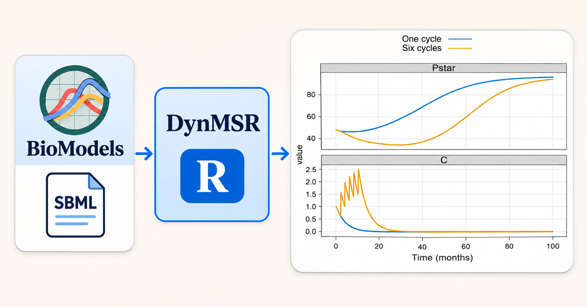
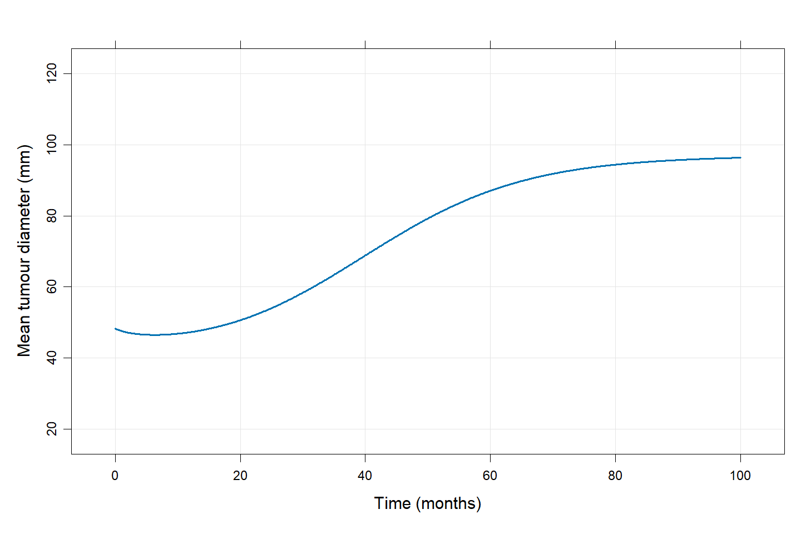
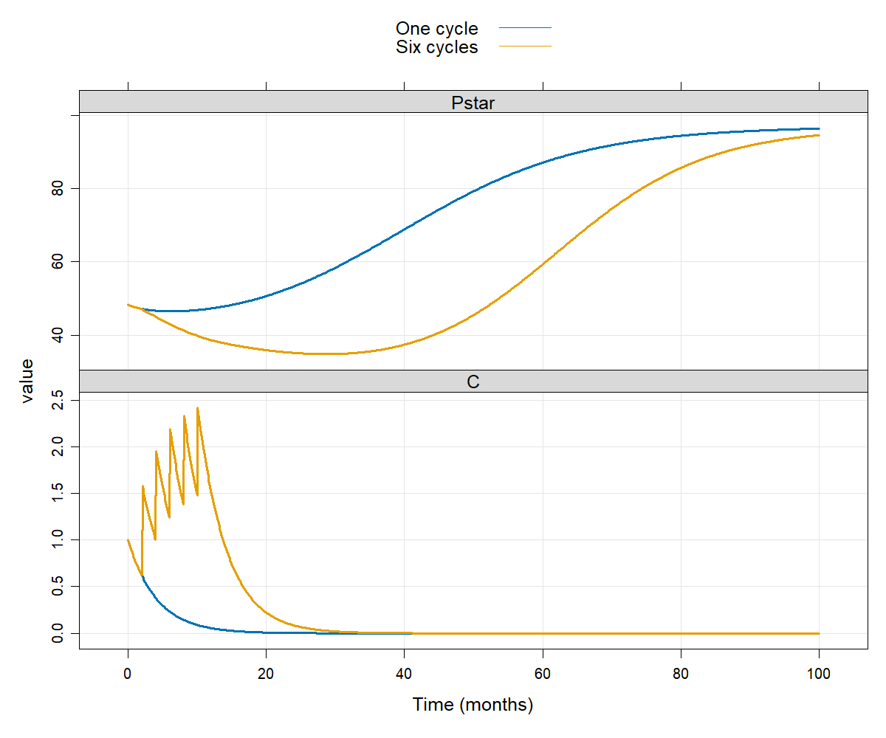

# Run SBML models in R

*Bring published models from BioModels into your QSP workflow*



Published models can save us weeks of work. The equations have already been developed, and a machine-readable model is available in a database. Yet reusing it often starts with an unnecessary task: rewriting those equations for another simulation environment.

**What if we could download an SBML model and run it directly from R?**

**[BioModels](https://www.ebi.ac.uk/biomodels/)** provides a large collection of published mechanistic models, many available in **SBML**. With **[DynMSR](https://cran.r-project.org/package=DynMSR)**, we can bring those models into R, build them for simulation with **mrgsolve**, and begin exploring their behavior without manually transcribing the equations.

_In this guide, we will run a **model of glioma growth and treatment**, then add repeated treatment cycles using a few lines of **Heta** code._

## What DynMSR does

[DynMSR](https://github.com/hetalang/DynMSR) provides an R interface for models in SBML, Heta, and **DynMS** formats. It handles model loading and prepares the model for simulation with mrgsolve.

We can also modify or extend the model using Heta syntax.

## Install the tools

1. Install the R packages: `install.packages(c("DynMSR", "mrgsolve"))`

2. Install **Heta Compiler** using the [instructions for your operating system](https://hetalang.github.io/hetacompiler/installation.html). mrgsolve also needs a working C++ toolchain; see its [installation guide](https://mrgsolve.org/user-guide/install.html).

The example below was checked with DynMSR 0.1.2, mrgsolve 2.0.1, and Heta Compiler 0.12.3.

## Download a model from BioModels

We will use [BIOMD0000000521](https://www.ebi.ac.uk/biomodels/BIOMD0000000521), a model published in [Ribba et al. (2012), *A Tumor Growth Inhibition Model for Low-Grade Glioma Treated with Chemotherapy or Radiotherapy*](https://doi.org/10.1158/1078-0432.CCR-12-0084).

The model describes proliferating tumour tissue (`P`), quiescent tissue (`Q`), and damaged quiescent tissue (`Qp`). Their sum, `Pstar`, represents mean tumour diameter. Treatment can eliminate proliferating tissue and damage quiescent tissue, which can later recover or be lost. These processes produce a delayed response followed by tumour regrowth.

The fourth variable, `C`, represents the concentration of a **virtual drug** combining the effects of the PCV regimen. It decays exponentially. Its units are arbitrary: this is a simplified treatment-exposure model, rather than separate PK models for the three drugs.

Download the **[SBML XML file](https://www.ebi.ac.uk/biomodels/model/download/BIOMD0000000521?filename=BIOMD0000000521_url.xml)** and keep the original filename. The available version is **SBML Level 2 Version 4**.

Use this directory structure:

```text
ribba2012/
    BIOMD0000000521_url.xml
    run-1.R
    index.heta
    run-2.R
```

Only the XML file and `run-1.R` are needed for the first step.

## Step 1: run the downloaded model

Put the following code in `ribba2012/run-1.R`:

```r
library(DynMSR)
# heta_check() # Optional: check Heta Compiler installation.
library(mrgsolve)

# Load SBML and build the simulation model.
platform <- sbml_load("ribba2012/BIOMD0000000521_url.xml")
model <- get_model(platform, 1)
mrgs_model <- build_mrgsolve(model, observables = "Pstar")

# Simulate 100 months and plot tumour diameter.
sim1 <- mrgsim(mrgs_model, end = 100, delta = 0.1)
plot(sim1, Pstar ~ time, ylim = c(20, 120),
     xlab = "Time (months)", ylab = "Mean tumour diameter (mm)")
```

This uses the equations, parameters, and initial conditions supplied in the downloaded SBML file.



The simulated curve matches the [BioModels curation image](https://www.ebi.ac.uk/biomodels/model/download/BIOMD0000000521?filename=curation_image.png) within the precision of the image.

## Step 2: add repeated treatment cycles with Heta

**What happens if treatment is repeated instead of given only once?** Include the SBML and add a treatment schedule in `ribba2012/index.heta`:

```text
// Original SBML, unchanged.
include ./BIOMD0000000521_url.xml type sbml;

// Five extra cycles; C(0) = 1 already supplies the first.
repeat_cycle @TimeSwitcher { start: 2, period: 2, stop: 10 };

// Add one dose; the paper instead resets C to 1.
C [repeat_cycle]= 1 + C;
```

This illustrative schedule gives six cycles at months 0, 2, 4, 6, 8, and 10. In `ribba2012/run-2.R`, load the model once and switch the periodic event off or on:

```r
# Run from the directory containing ribba2012/.
library(DynMSR)
library(mrgsolve)

# Load and compile once.
mrgs_model <- heta_load('ribba2012') |>
  get_model(1) |>
  build_mrgsolve(observables = c('C', 'Pstar'))

# One cycle: periodic event off.
single <- param(mrgs_model, repeat_cycle__active__ = 0) |>
  mrgsim_df(end = 100, delta = 0.1)
# Six cycles: periodic event on.
repeated <- param(mrgs_model, repeat_cycle__active__ = 1) |>
  mrgsim_df(end = 100, delta = 0.1)

# Compare exposure and tumour response.
comparison <- rbind(
  transform(single, scenario = 'One cycle'),
  transform(repeated, scenario = 'Six cycles')
)
plot_sims(comparison, C, Pstar, .dots = list(
  groups = comparison$scenario,
  layout = c(1, 2),
  xlab = 'Time (months)',
  auto.key = list(space = 'top', lines = TRUE, points = FALSE)
))
```



Repeated cycles sustain exposure and produce a greater, longer-lasting reduction in tumour diameter. The response continues after the last cycle because damaged tissue is lost over time. Tumour growth eventually resumes as treatment exposure declines.

This is an illustrative dosing schedule applied to the BioModels version, which has documented differences from the original paper. It is an example of model extension, rather than a clinical treatment recommendation.

## Start from an existing model

**Download an SBML model, load it in R, and simulate it.** Once you have compared the result with an available reference, use Heta to modify or extend the model and explore your own questions, from treatment schedules to additional biological mechanisms.

Try [DynMSR](https://cran.r-project.org/package=DynMSR) with a model from BioModels. Examples and the issue tracker are available in the [DynMSR repository](https://github.com/hetalang/DynMSR).
